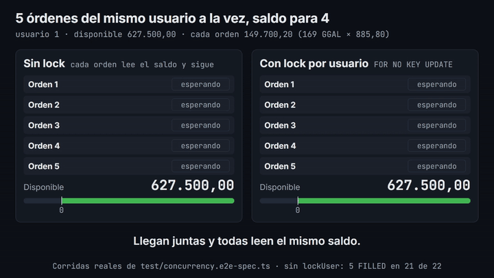
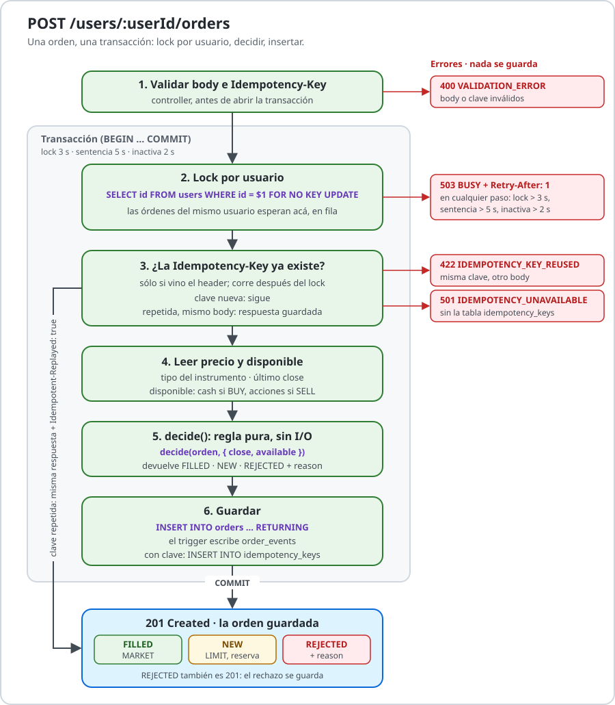
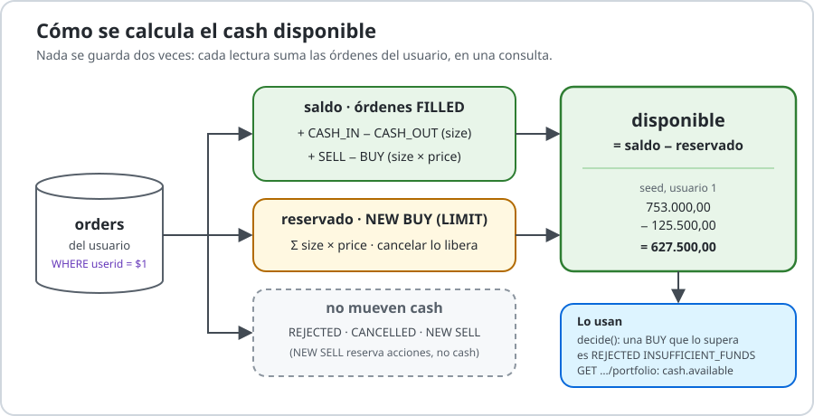

# Cocos Challenge: portfolio, búsqueda y órdenes

API en NestJS + Postgres para el [enunciado](backend-challenge.md). Lo difícil es que el dinero cierre con órdenes en paralelo. Las decisiones y sus alternativas están en [DECISIONS.md](DECISIONS.md).



El caso que resuelve: 5 órdenes del mismo usuario llegan a la vez y cada una lee el mismo disponible antes de que otra lo gaste. Sin lock se ejecutan las 5 y el disponible queda en −121.001,00. Con un lock por usuario corren de a una: 4 FILLED y la quinta REJECTED (D-04). Son corridas reales de [`test/concurrency.e2e-spec.ts`](test/concurrency.e2e-spec.ts), con y sin `lockUser`.

Seed, usuario 1: cash 753.000,00, reservado 125.500,00 (dos LIMIT BUY NEW), disponible 627.500,00, valor total 889.756,00. Es el primer test (`test/portfolio.e2e-spec.ts`); las anomalías del seed están en D-11.

## Correr

```bash
docker compose up --build     # Postgres con el seed + API en http://localhost:3000
```

Ejemplos en [requests.http](requests.http). Contra otra base, por ejemplo la provista:

```bash
npm ci
cp .env.example .env   # y poné la DATABASE_URL de esa base
npm run start:dev
```

<details>
<summary>La API en 40 segundos (respuestas reales)</summary>


</details>

<details>
<summary>Los mismos pasos por escrito (respuestas recortadas)</summary>

Son las respuestas reales del GIF. Están recortadas: faltan campos, y en el portfolio no se muestran las posiciones.

#### 1. Buscar un instrumento

```http
GET /instruments?q=GGAL
```

Respuesta: `200 OK`

```json
[
  {
    "id": 34,
    "ticker": "GGAL",
    "name": "Grupo Financiero Galicia",
    "type": "ACCIONES"
  }
]
```

#### 2. Ver el portfolio

```http
GET /users/1/portfolio
```

Respuesta: `200 OK`

```json
{
  "totalValue": "889756.00",
  "cash": {
    "balance": "753000.00",
    "reserved": "125500.00",
    "available": "627500.00"
  }
}
```

#### 3. Comprar por monto, con clave de idempotencia

```http
POST /users/1/orders
Content-Type: application/json
Idempotency-Key: demo-video-1

{
  "instrumentId": 34,
  "side": "BUY",
  "type": "MARKET",
  "amount": "10000"
}
```

Respuesta: `201 Created`

```json
{
  "id": 12,
  "type": "MARKET",
  "size": 11,
  "price": "885.80",
  "status": "FILLED"
}
```

#### 4. Reintentar el mismo POST con la misma clave

El mismo request del paso 3, sin cambios.

Respuesta: `201 Created`, con el header `Idempotent-Replayed: true`

```json
{
  "id": 12,
  "type": "MARKET",
  "size": 11,
  "price": "885.80",
  "status": "FILLED"
}
```

Es la misma orden `12`. No se crea una nueva.

#### 5. Una LIMIT queda NEW y reserva

```http
POST /users/1/orders
Content-Type: application/json

{
  "instrumentId": 34,
  "side": "BUY",
  "type": "LIMIT",
  "size": 10,
  "price": "850.00"
}
```

Respuesta: `201 Created`

```json
{
  "id": 13,
  "type": "LIMIT",
  "size": 10,
  "price": "850.00",
  "status": "NEW"
}
```

En `GET /users/1/portfolio`, `reserved` pasa de `125500.00` a `134000.00` (10 × 850.00).

#### 6. Cancelarla libera la reserva

```http
POST /users/1/orders/13/cancel
```

Respuesta: `200 OK`

```json
{
  "id": 13,
  "type": "LIMIT",
  "size": 10,
  "price": "850.00",
  "status": "CANCELLED"
}
```

En `GET /users/1/portfolio`, `reserved` vuelve a `125500.00`.

#### 7. Sin fondos: REJECTED, y la orden queda guardada

```http
POST /users/1/orders
Content-Type: application/json

{
  "instrumentId": 50,
  "side": "BUY",
  "type": "MARKET",
  "size": 1000
}
```

Respuesta: `201 Created`

```json
{
  "id": 14,
  "type": "MARKET",
  "size": 1000,
  "price": "7837.50",
  "status": "REJECTED",
  "reason": "INSUFFICIENT_FUNDS"
}
```

</details>

La app no crea ni migra nada. Idempotencia y auditoría necesitan `psql "$DATABASE_URL" -f db/local-additions.sql`; sin eso, `Idempotency-Key` recibe 501 (D-10).

## Verificar

```bash
npm run verify   # lint + format + typecheck + unit + e2e contra Postgres real (Testcontainers)
```

Necesita Docker, Node 24+ y `npm ci`; ~1-2 min. El test funcional de enviar una orden es [`test/orders.e2e-spec.ts`](test/orders.e2e-spec.ts). Cada test o archivo usa una base nueva; el harness se niega a correr contra un host no local. CI corre lo mismo.

## Endpoints

| Método y ruta | Qué hace |
|---|---|
| `GET /users/:userId/portfolio` | Valor total, cash (saldo, reservado, disponible) y posiciones con valor y rendimiento total y diario |
| `GET /instruments?q=gal` | Busca parcial por ticker o nombre; ticker exacto primero |
| `POST /users/:userId/orders` | Envía una orden. Header opcional `Idempotency-Key` |
| `POST /users/:userId/orders/:orderId/cancel` | Cancela una orden NEW |

Orden: `{ "instrumentId": 34, "side": "BUY", "type": "MARKET", "size": 10 }`, o `amount` (ARS) en lugar de `size`. `LIMIT` necesita `price`; `MARKET` toma el último `close`. El dinero viaja como string: `"price": "900.00"`.

## Cómo se procesa una orden



El cash no se guarda: se deriva de `orders` en cada lectura (D-02, D-03).



## Qué responde cada caso

| Caso | HTTP | Se guarda |
|---|---|---|
| MARKET con fondos o acciones | 201 `FILLED` | sí |
| LIMIT con fondos o acciones (los reserva) | 201 `NEW` | sí |
| Más que el disponible, vender BMA, MARKET sin precio, o monto menor a una acción | 201 `REJECTED` + `reason` | sí |
| Body inválido, `CASH_IN`/`CASH_OUT`, comprar ARS o monto fuera de rango | 400 | no |
| Body de más de 100 kB / body que no es JSON UTF-8 | 413 / 415 | no |
| Usuario, instrumento u orden inexistente o ajena | 404 | no |
| Cancelar una orden que no está NEW | 409 | no |
| Misma `Idempotency-Key` con otro body | 422 | no |
| `Idempotency-Key` sin la tabla de idempotencia | 501 | no |
| Lock, sentencia, transacción inactiva o pool fuera de tiempo; base caída o que no responde al conectar | 503 + `Retry-After` | no |
| Error inesperado (conexión perdida a mitad de transacción, bug) | 500 | desconocido: reintentar con la misma `Idempotency-Key` |

Errores en RFC 9457 (`application/problem+json`) con un `code` estable. Cada fila tiene un test e2e, salvo la base caída o que no responde al conectar (unitario, `src/common/problem.spec.ts`).

## Cómo lo llevaría a producción

Elegí lo más simple que cumple el enunciado y se puede probar. Cada fila dice qué hice, por qué, y qué cambiaría.

| Tema | Hoy, y por qué | En producción |
|---|---|---|
| Usuarios | `userId` en la ruta: el enunciado no pide autenticación | El usuario sale del token, no de la URL |
| Cash y posiciones | Se suman desde `orders` en cada lectura: una sola fuente de verdad (D-02) | Tabla de saldos y posiciones escrita en la misma transacción, con reconciliación nocturna contra `orders` |
| Concurrencia | Lock por usuario en Postgres: sólo serializa a ese usuario (D-04) | El mismo lock sirve con N instancias (pods en EKS contra RDS PostgreSQL); un límite por usuario en la app para que el burst de uno no ocupe el pool de todos |
| Órdenes LIMIT | Quedan NEW y reservadas hasta cancelarse (D-03) | Un proceso las ejecuta bajo el mismo lock; al cierre, en días hábiles, un CronJob en EKS pasa a CANCELLED las creadas antes del cierre |
| Depósitos y retiros | Se cuentan, no se crean (D-14) | Endpoints aparte, autenticados, con el mismo lock |
| Esquema | No cambio el provisto; lo opcional va en `db/local-additions.sql` (D-10) | Migraciones versionadas e índices `orders (userid, status)` y `marketdata (instrumentid, date DESC NULLS LAST, id DESC)` |
| Timeouts | Los aplica Postgres: 3 s de lock, 5 s por sentencia (D-04) | `query_timeout` en el cliente, health check para el ALB y logs JSON con id de request en CloudWatch Logs |
| Telemetría | Un log JSON por orden y por cancelación (`status`, `reason`): sin infraestructura, alcanza para seguir una orden | OpenTelemetry, con métricas y alarmas en CloudWatch y trazas en X-Ray: latencia de las órdenes, 503 por lock o pool y REJECTED por `reason` |
| Idempotencia | Clave en Postgres, en la misma transacción que la orden (D-13) | Borrar claves de más de 24 h |
| Búsqueda | `ILIKE` parcial, máximo 20 (D-12) | Índice `pg_trgm`, sin acentos (`unaccent`) y paginada |
| Cache | No hay: son 66 instrumentos y cada lectura es una consulta corta a Postgres | `Cache-Control: public, max-age=60` en `GET /instruments` (el catálogo casi no cambia y no trae datos del usuario) y último precio en ElastiCache (Redis) con TTL corto, sólo para valuar el portfolio. Cash, reservas, posiciones y el precio de una orden se leen siempre de Postgres: un saldo viejo es un doble gasto (D-04) |
| Deploy | GitHub Actions corre `npm run verify` y un smoke test con docker compose; no despliega: se corre local | El mismo workflow construye la imagen, la sube a ECR y despliega en EKS; se autentica en AWS con OIDC, sin claves guardadas |
| Infraestructura | No hay más que `docker-compose.yml` (API + Postgres): se corre local | Terraform para EKS, RDS, ECR y el rol de IAM que GitHub Actions asume por OIDC; estado remoto en S3, y `terraform plan` en cada PR |

## Revisar en 15 minutos

1. [`src/orders/orders.service.ts`](src/orders/orders.service.ts) `place()`: lock → instrumento, precio y disponible → decidir → insertar, en una transacción.
2. [`src/ledger.repository.ts`](src/ledger.repository.ts) `lockUser` y [`src/database/db.ts`](src/database/db.ts): el lock por usuario y los límites de tiempo.
3. [`src/orders/decide.ts`](src/orders/decide.ts) y [`src/portfolio/positions.ts`](src/portfolio/positions.ts): reglas de negocio puras, con tests unitarios.
4. [`test/concurrency.e2e-spec.ts`](test/concurrency.e2e-spec.ts): la carrera, probada. [`test/harness.ts`](test/harness.ts) `assertInvariants` revisa cada base antes de cerrarla.
